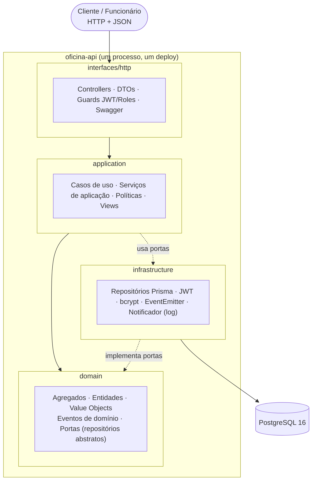
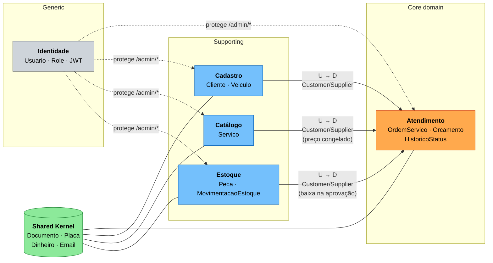
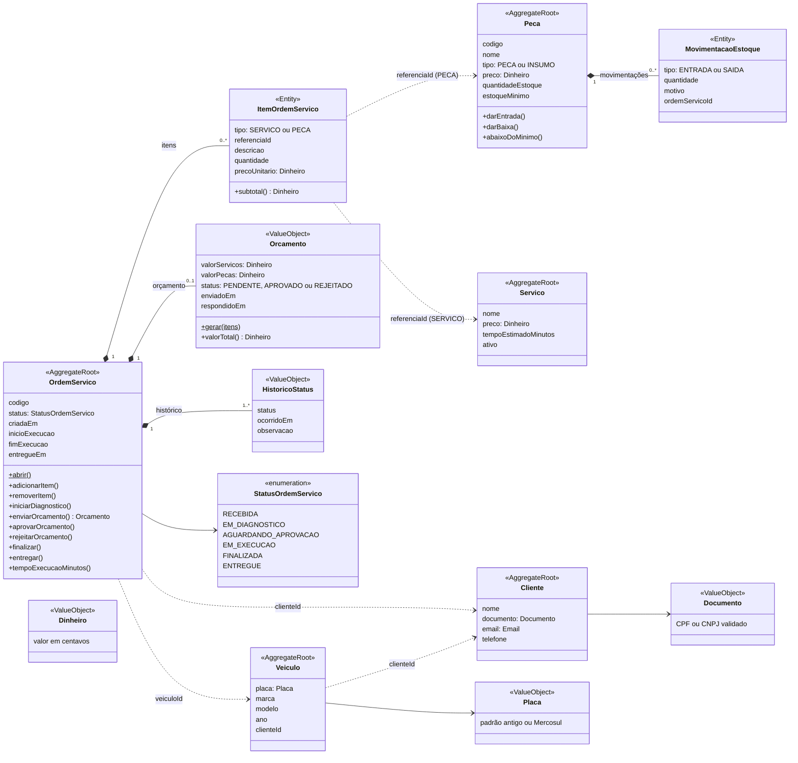
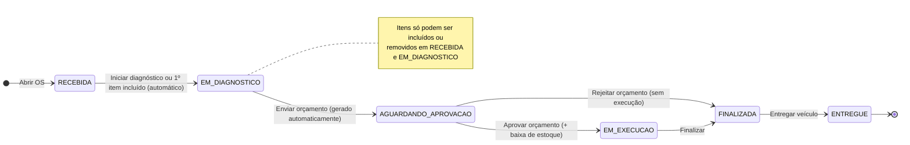
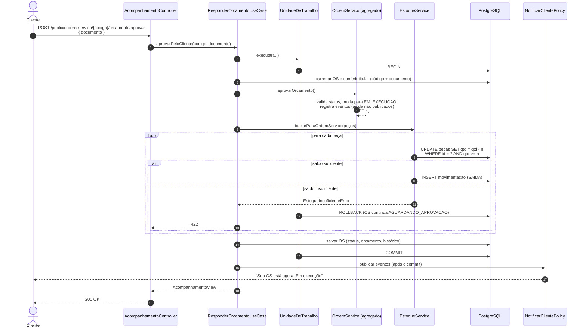
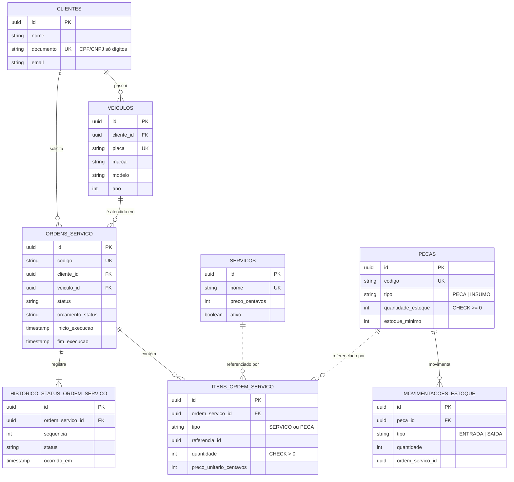

# Diagramas: Oficina Mecânica

Diagramas da solução entregue, em [Mermaid](https://mermaid.js.org/), que o GitHub renderiza direto. Os mesmos diagramas estão no [board do FigJam](https://www.figma.com/board/OSi3ythINp208qJgHLLyOh), à direita dos fluxos de Event Storming. A exportação em PDF fica em [diagramas.pdf](diagramas.pdf).

> Para exportar sem redesenhar: cole o bloco no [Mermaid Live Editor](https://mermaid.live) e use *Actions → PNG/SVG*. O diagrama de classes (seção 3) aparece no FigJam como flowchart de agregados, porque o FigJam não importa diagramas de classe.

| # | Diagrama | Para que serve |
|---|---|---|
| 1 | [Arquitetura em camadas](#1-arquitetura-em-camadas-monólito-modular) | Como o monólito está organizado |
| 2 | [Mapa de contextos](#2-mapa-de-contextos-bounded-contexts) | Bounded contexts e como se relacionam |
| 3 | [Modelo de domínio](#3-modelo-de-domínio-agregados-entidades-e-objetos-de-valor) | Agregados, entidades e objetos de valor |
| 4 | [Máquina de estados da OS](#4-máquina-de-estados-da-ordem-de-serviço) | Status e regras de transição |
| 5 | [Sequência: aprovação do orçamento](#5-sequência-aprovação-do-orçamento-transação-e-eventos) | Transação, baixa de estoque e eventos |
| 6 | [Modelo de dados](#6-modelo-de-dados-postgresql) | Tabelas e relacionamentos no PostgreSQL |

---

## 1. Arquitetura em camadas (monólito modular)

Cada bounded context é um módulo NestJS com as mesmas quatro camadas. As dependências apontam **para o domínio**, que não conhece framework nem ORM.

| Camada | Pasta | Conteúdo |
|---|---|---|
| Interfaces | `src/modules/*/interfaces/http` | Controllers REST, DTOs com `class-validator`, guards |
| Aplicação | `src/modules/*/application` | Casos de uso (`*.use-case.ts`), serviços, políticas, views |
| Domínio | `src/modules/*/domain`, `src/shared/domain` | Regras de negócio puras, sem dependência de framework |
| Infraestrutura | `src/modules/*/infrastructure`, `src/shared/infrastructure` | Prisma, transações (CLS), JWT, eventos |

---

## 2. Mapa de contextos (bounded contexts)

| Contexto | Tipo | Relação com Atendimento | Integração no código |
|---|---|---|---|
| **Atendimento** | Core | | `src/modules/atendimento` |
| **Cadastro** | Supporting | Upstream (fornecedor) | `ClientesService`, `VeiculosService` |
| **Catálogo** | Supporting | Upstream; o preço vira *snapshot* no item da OS | `ServicosService` |
| **Estoque** | Supporting | Upstream; baixa síncrona na mesma transação | `PecasService`, `EstoqueService` |
| **Identidade** | Generic | Transversal (autenticação/autorização) | `JwtAuthGuard`, `RolesGuard` |
| **Shared Kernel** | | Compartilhado por todos | `src/shared/domain` |

*U → D = upstream → downstream.* Por ser um monólito, a integração é por chamada em processo, nunca por acesso direto às tabelas de outro contexto.

---

## 3. Modelo de domínio: agregados, entidades e objetos de valor

**Leitura do diagrama:**
- Linha cheia com losango (`*--`): **composição** dentro do agregado. Só a raiz é acessada de fora e é persistida junto.
- Linha tracejada (`..>`): **referência por identidade** a outro agregado (só o `id`, nunca o objeto). É assim que agregados se referenciam em DDD.
- As invariantes de cada agregado estão em [linguagem-ubiqua.md §4](linguagem-ubiqua.md#4-agregados-entidades-e-objetos-de-valor).

---

## 4. Máquina de estados da Ordem de Serviço

| De | Para | Comando | Quem |
|---|---|---|---|
| — | Recebida | Abrir OS | Atendente |
| Recebida | Em diagnóstico | Iniciar diagnóstico / incluir 1º item | Mecânico (ou automático) |
| Em diagnóstico | Aguardando aprovação | Enviar orçamento | Mecânico / Atendente |
| Aguardando aprovação | Em execução | Aprovar orçamento | Cliente (API pública) / Atendente |
| Aguardando aprovação | Finalizada | Rejeitar orçamento | Cliente (API pública) / Atendente |
| Em execução | Finalizada | Finalizar | Mecânico |
| Finalizada | Entregue | Entregar veículo | Atendente |

Qualquer outra transição é recusada com `TransicaoStatusInvalidaError` (HTTP 422). Código: `TRANSICOES_PERMITIDAS` em `atendimento/domain/status-ordem-servico.ts`.

---

## 5. Sequência: aprovação do orçamento (transação e eventos)

O fluxo mais sensível: a mudança de status e a baixa de estoque precisam ser **atômicas**, e o cliente só é notificado **depois do commit**.

Testes que comprovam esse comportamento (`test/e2e/oficina.e2e-spec.ts`):
- *falha de estoque na 2ª peça desfaz a baixa da 1ª e mantém a OS aguardando (rollback)*
- *aprovações concorrentes não deixam o estoque negativo*

---

## 6. Modelo de dados (PostgreSQL)

Os atributos mostrados são os principais; o esquema completo está em `prisma/schema.prisma` e `prisma/migrations/`. A tabela de usuários (contexto Identidade) é independente e foi omitida. A justificativa do PostgreSQL está no [README §9](../../README.md#9-banco-de-dados-decisão-e-justificativa).
