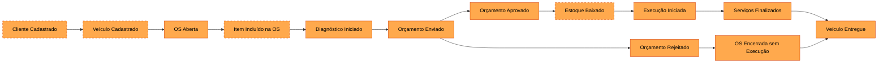
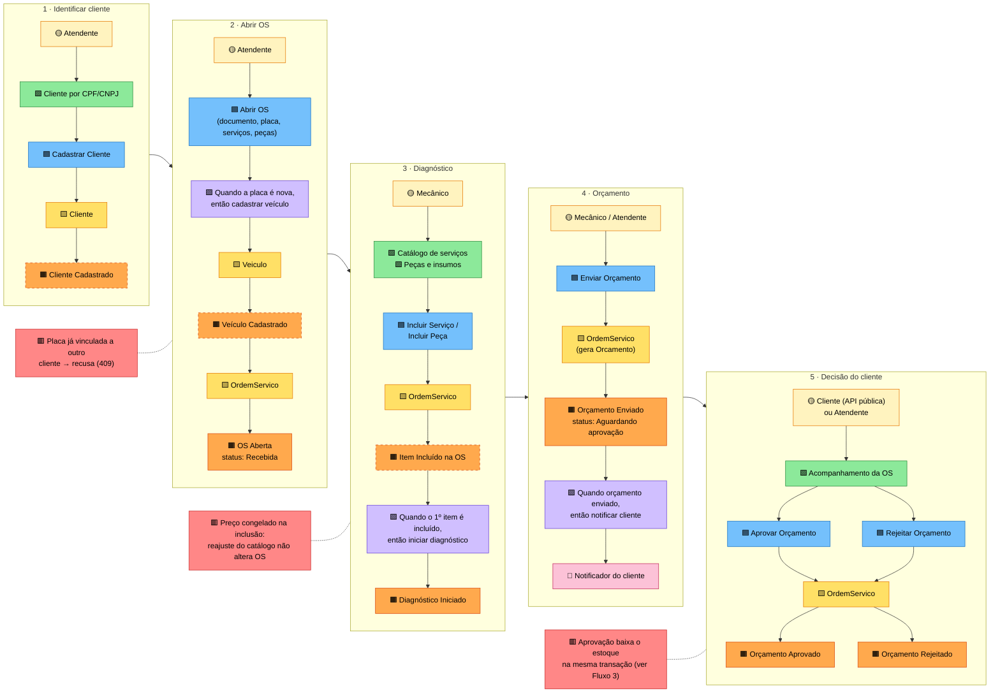
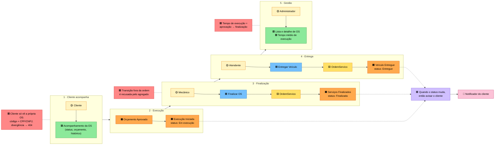
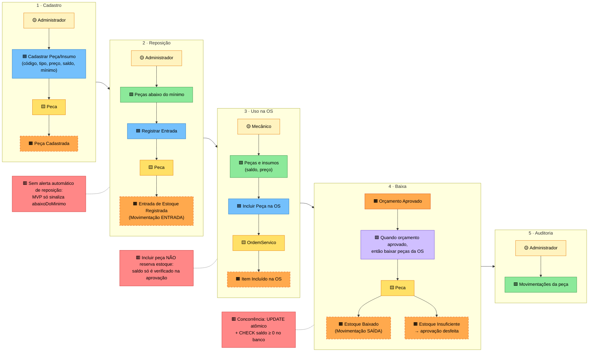

# Event Storming: Oficina Mecânica

Este documento é a versão em texto do **board de Event Storming no FigJam**. Cada bloco colorido abaixo corresponde a um post-it. Os três fluxos pedidos no Tech Challenge estão aqui na ordem da linha do tempo, da esquerda para a direita, e **foram levantados a partir do código entregue**: todo evento, comando, política e read model tem um arquivo correspondente, indicado nas tabelas.

> **Board no FigJam:** <https://www.figma.com/board/OSi3ythINp208qJgHLLyOh>. Ele tem a legenda, os 3 fluxos em post-its e os diagramas. Exportação em PDF: [event-storming.pdf](event-storming.pdf)

---

## Como o board está montado

### Legenda (cores padrão do Event Storming)

| Post-it | Cor no board | Significado | Como escrever |
|---|---|---|---|
| 🟧 **Evento de domínio** | Laranja | Algo relevante que **aconteceu** no negócio | Verbo no **particípio**: *OS Aberta*, *Orçamento Aprovado* |
| 🟧 **Fato registrado** | Laranja, com "(fato registrado)" no texto (borda tracejada nos diagramas abaixo) | Fato de negócio que o sistema **grava**, mas que não é publicado como evento no código | Igual ao evento |
| 🟦 **Comando** | Azul | Intenção / decisão de um ator que dispara o evento | Verbo no **imperativo**: *Abrir OS*, *Enviar Orçamento* |
| 🟨 **Agregado** | Amarelo | Quem recebe o comando e garante as regras | Substantivo: *OrdemServico*, *Peca* |
| 🟪 **Política** | Lilás | Reação automática: "**quando** X, **então** Y" | *Quando orçamento enviado, então notificar cliente* |
| 🟩 **Read model** | Verde | Informação que o ator consulta para decidir | *Catálogo de serviços*, *Acompanhamento da OS* |
| 🟡 **Ator** | Branco no FigJam (amarelo claro pequeno no padrão clássico) | Quem executa o comando | *Atendente*, *Mecânico*, *Cliente* |
| 🩷 **Sistema externo** | Rosa | Algo fora do domínio | *Notificador (e-mail/SMS)* |
| 🟥 **Hotspot** | Vermelho / rosa forte | Dúvida, risco, regra polêmica ou decisão tomada | *Peça não reserva estoque ao ser incluída* |

### Layout do board

1. **Uma seção por fluxo**: *Criação da OS*, *Acompanhamento da OS*, *Gestão de peças e insumos*. Dentro de cada seção, a linha do tempo corre da esquerda para a direita, com um passo por coluna.
2. **Cada coluna é a "receita" de um passo**, de cima para baixo: Ator 🟡 → Read model 🟩 → Comando 🟦 → Agregado 🟨 → **Evento 🟧** → Política 🟪 → Sistema externo 🩷.
3. **Hotspots 🟥** ficam embaixo da coluna a que se referem.
4. **À direita, os diagramas:** mapa de contextos, agregados, máquina de estados, sequência da aprovação, modelo de dados e camadas (veja [diagramas.md](diagramas.md)).
5. Para exportar: selecione as seções e use *⋯ → Export → PDF*, salvando como `docs/ddd/event-storming.pdf` (fluxos) e `docs/ddd/diagramas.pdf` (diagramas).

```mermaid
flowchart LR
  A["🟡 Ator"]:::ator --> R["🟩 Read model"]:::readmodel --> C["🟦 Comando"]:::comando --> G["🟨 Agregado"]:::agregado --> E["🟧 Evento"]:::evento --> P["🟪 Política"]:::politica
  P -. "dispara novo" .-> C2["🟦 Comando"]:::comando

  classDef evento fill:#FFA94D,stroke:#D9480F,color:#000
  classDef fato fill:#FFA94D,stroke:#D9480F,stroke-dasharray:5 5,color:#000
  classDef comando fill:#74C0FC,stroke:#1971C2,color:#000
  classDef agregado fill:#FFE066,stroke:#E67700,color:#000
  classDef politica fill:#D0BFFF,stroke:#6741D9,color:#000
  classDef readmodel fill:#8CE99A,stroke:#2B8A3E,color:#000
  classDef ator fill:#FFF3BF,stroke:#E67700,color:#000
  classDef externo fill:#FCC2D7,stroke:#C2255C,color:#000
  classDef hotspot fill:#FF8787,stroke:#C92A2A,color:#000
```

---

## Big picture: linha do tempo completa

Todos os eventos dos três fluxos, na ordem em que acontecem num atendimento típico:

> Os eventos *Diagnóstico Iniciado*, *Execução Iniciada*, *Serviços Finalizados*, *OS Encerrada sem Execução* e *Veículo Entregue* são publicados no código como **um único evento técnico**, `ordem-servico.status-alterado`, com `de` e `para` no payload. No board, escreva-os separados (linguagem do negócio) e anote o nome técnico no canto do post-it.

### Eventos de domínio publicados no código

| Evento no board | Nome técnico | Disparado por | Arquivo |
|---|---|---|---|
| OS Aberta | `ordem-servico.aberta` | `OrdemServico.abrir()` | `atendimento/domain/ordem-servico.ts` |
| Status Alterado *(Diagnóstico Iniciado, Execução Iniciada, …)* | `ordem-servico.status-alterado` | toda transição (`transicionar()`) | `atendimento/domain/ordem-servico.ts` |
| Orçamento Enviado | `ordem-servico.orcamento-enviado` | `enviarOrcamento()` | `atendimento/domain/ordem-servico.ts` |
| Orçamento Aprovado | `ordem-servico.orcamento-aprovado` | `aprovarOrcamento()` | `atendimento/domain/ordem-servico.ts` |
| Orçamento Rejeitado | `ordem-servico.orcamento-rejeitado` | `rejeitarOrcamento()` | `atendimento/domain/ordem-servico.ts` |

Lista oficial: `EventosOrdemServico` em `src/modules/atendimento/domain/eventos.ts`. Os eventos são publicados **só depois do commit** da transação (`OrdemServicoSuporte.executarComando`).

---

## Fluxo 1: Criação da Ordem de Serviço

**Escopo:** do cliente chegando à oficina até a decisão sobre o orçamento.

| # | Ator | Comando | Agregado | Evento | Política / regra | Rota e código |
|---|---|---|---|---|---|---|
| 1 | Atendente | Cadastrar Cliente | `Cliente` | Cliente Cadastrado *(fato)* | CPF/CNPJ válido e único | `POST /admin/clientes` · `ClientesService.criar` |
| 2 | Atendente | Abrir OS | `OrdemServico`, `Veiculo` | OS Aberta, Veículo Cadastrado *(fato)* | Placa nova ⇒ cadastra veículo; placa de outro cliente ⇒ 409 | `POST /admin/ordens-servico` · `AbrirOrdemServicoUseCase` |
| 3 | Mecânico / Atendente | Incluir Serviço / Incluir Peça | `OrdemServico` | Item Incluído *(fato)* → Diagnóstico Iniciado | 1º item ⇒ *Em diagnóstico*; serviço inativo é recusado; itens só editáveis antes do orçamento | `POST /admin/ordens-servico/:id/servicos` e `/pecas` · `GerenciarItensOrdemServicoUseCase` |
| 3' | Mecânico | Iniciar Diagnóstico *(explícito, sem item)* | `OrdemServico` | Diagnóstico Iniciado | Só a partir de *Recebida* | `POST /admin/ordens-servico/:id/diagnostico` · `AlterarStatusOrdemServicoUseCase` |
| 4 | Mecânico / Atendente | Enviar Orçamento | `OrdemServico` (`Orcamento` VO) | Orçamento Enviado | Orçamento calculado pelo sistema, exige ≥ 1 item; **quando enviado, então notificar o cliente** | `POST /admin/ordens-servico/:id/orcamento/enviar` · `NotificarClientePolicy` |
| 5a | Cliente / Atendente | Aprovar Orçamento | `OrdemServico` + `Peca` | Orçamento Aprovado → Execução Iniciada | Baixa todas as peças na mesma transação; faltou uma ⇒ nada muda | `POST /public/ordens-servico/:codigo/orcamento/aprovar` · `ResponderOrcamentoUseCase` |
| 5b | Cliente / Atendente | Rejeitar Orçamento | `OrdemServico` | Orçamento Rejeitado → OS Encerrada sem Execução | Estoque não é movimentado | `POST /public/ordens-servico/:codigo/orcamento/rejeitar` |

---

## Fluxo 2: Acompanhamento da Ordem de Serviço

**Escopo:** a execução, o acompanhamento pelo cliente e a entrega, além da métrica de tempo médio.

| # | Ator | Comando / consulta | Agregado | Evento | Política / regra | Rota e código |
|---|---|---|---|---|---|---|
| 1 | Cliente | *Consultar andamento* (read model) | | | Documento mascarado; código + documento obrigatórios | `GET /public/ordens-servico/:codigo` · `AcompanhamentoController` |
| 2 | Sistema | (efeito da aprovação) | `OrdemServico` | Execução Iniciada | Registra `inicioExecucao` | `aprovarOrcamento()` |
| 3 | Mecânico | Finalizar OS | `OrdemServico` | Serviços Finalizados | Só a partir de *Em execução*; registra `fimExecucao` | `POST /admin/ordens-servico/:id/finalizar` · `AlterarStatusOrdemServicoUseCase` |
| 4 | Atendente | Entregar Veículo | `OrdemServico` | Veículo Entregue | Só a partir de *Finalizada* | `POST /admin/ordens-servico/:id/entregar` |
| 5 | Administrador | *Listar / detalhar OS*, *tempo médio* (read models) | | | Média geral e por serviço das OS concluídas | `GET /admin/ordens-servico`, `GET /admin/metricas/tempo-medio-execucao` · `OrdemServicoConsultas`, `CalcularTempoMedioExecucaoUseCase` |
| * | Sistema | | | *(qualquer Status Alterado)* | **Quando o status muda, então avisar o cliente** | `NotificarClientePolicy.quandoStatusAlterado` |

**Transições permitidas** (regra aplicada pelo agregado; o diagrama completo está em [diagramas.md](diagramas.md#4-máquina-de-estados-da-ordem-de-serviço)):
*Recebida → Em diagnóstico → Aguardando aprovação → Em execução → Finalizada → Entregue*, além de *Aguardando aprovação → Finalizada* (rejeição).

---

## Fluxo 3: Gestão de peças e insumos

**Escopo:** cadastro, reposição, uso na OS e baixa de estoque.

> O contexto de **Estoque não publica eventos de domínio** no MVP. Seus fatos ficam registrados como `MovimentacaoEstoque` (trilha de auditoria imutável) e por isso aparecem como post-its de **borda tracejada**.

| # | Ator | Comando | Agregado | Evento / fato | Política / regra | Rota e código |
|---|---|---|---|---|---|---|
| 1 | Administrador | Cadastrar Peça/Insumo | `Peca` | Peça Cadastrada *(fato)* | Código único; tipo `PECA` ou `INSUMO`; saldo e mínimo ≥ 0 | `POST /admin/pecas` · `PecasService.criar` |
| 2 | Administrador | Registrar Entrada | `Peca` | Entrada Registrada *(movimentação `ENTRADA`)* | Quantidade inteira positiva; o saldo só muda por movimentação | `POST /admin/pecas/:id/entradas` · `EstoqueService.registrarEntrada` |
| 3 | Mecânico | Incluir Peça na OS | `OrdemServico` | Item Incluído *(fato)* | Preço vigente congelado; **sem reserva** de saldo | `POST /admin/ordens-servico/:id/pecas` |
| 4 | Sistema | (efeito de Aprovar Orçamento) | `Peca` | Estoque Baixado *(movimentação `SAIDA`)* ou Estoque Insuficiente | **Quando aprovado, então baixar todas as peças na mesma transação**; se faltar uma, rollback total | `EstoqueService.baixarParaOrdemServico` · `EstoqueInsuficienteError` |
| 5 | Administrador | *Consultar movimentações* (read model) | | | Trilha imutável de entradas e saídas | `GET /admin/pecas/:id/movimentacoes` |
| * | Administrador | *Listar peças abaixo do mínimo* (read model) | | | `abaixoDoMinimo` = saldo ≤ estoque mínimo | `GET /admin/pecas?abaixoDoMinimo=true` |

> A política "quando aprovado, então baixar estoque" é executada **de forma síncrona e na mesma transação** (`ResponderOrcamentoUseCase`), e não por um listener do evento. Foi uma decisão consciente: a aprovação e a baixa precisam ser atômicas. Anote isso no hotspot do board.

---

## Hotspots e decisões registradas

| Hotspot | Decisão no MVP | Onde |
|---|---|---|
| A rejeição leva a OS para *Finalizada* | A OS é encerrada sem execução e o veículo segue para entrega | `TRANSICOES_PERMITIDAS` |
| Notificação ao cliente | Porta `NotificadorCliente` com adaptador de **log**; e-mail/SMS/app ficam para a próxima fase | `log-notificador-cliente.ts` |
| Falha ao notificar | Não desfaz a operação de negócio (eventos após o commit) | `NotificarClientePolicy.enviar` |
| Reserva de estoque | Não há reserva na inclusão; o saldo é garantido só na aprovação | `OrdemServicoSuporte.itemDePeca` |
| Aprovação concorrente | `UPDATE … WHERE quantidade_estoque >= n` + `CHECK` no banco | `PrismaPecaRepository.ajustarSaldo` |
| Cliente precisa existir antes da OS | Abrir OS identifica, mas não cadastra cliente (o veículo, sim) | `AbrirOrdemServicoUseCase` |

Glossário e linguagem ubíqua: [linguagem-ubiqua.md](linguagem-ubiqua.md). Diagramas: [diagramas.md](diagramas.md).
