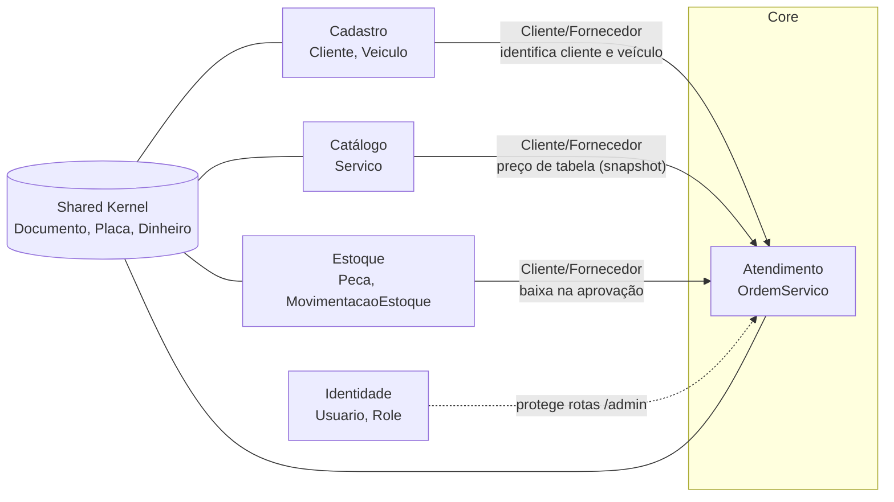
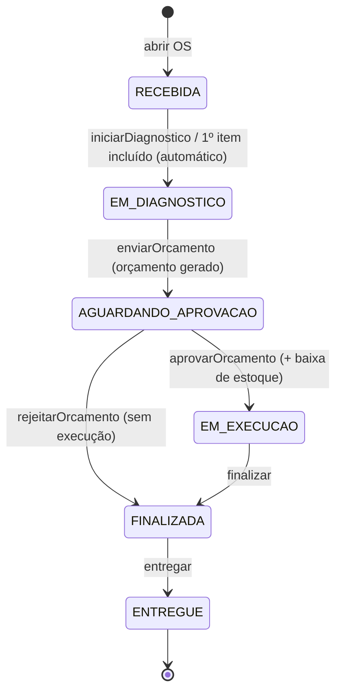

# Linguagem Ubíqua: Sistema Integrado de Atendimento e Execução de Serviços

Este documento registra o vocabulário compartilhado entre a oficina (especialistas do domínio) e o time de desenvolvimento. **Os termos abaixo são usados literalmente no código**: nomes de classes, métodos, enums e rotas. A coluna *Implementação* liga cada conceito ao arquivo correspondente.

---

## 1. Bounded Contexts

| Contexto | Tipo | Responsabilidade | Módulo |
|---|---|---|---|
| **Atendimento** | Core domain | Ciclo de vida da Ordem de Serviço: abertura, diagnóstico, orçamento, aprovação, execução, entrega e acompanhamento pelo cliente | `src/modules/atendimento` |
| **Cadastro** | Supporting | Clientes (CPF/CNPJ) e seus veículos | `src/modules/cadastro` |
| **Catálogo** | Supporting | Serviços oferecidos pela oficina e seus preços de tabela | `src/modules/catalogo` |
| **Estoque** | Supporting | Peças e insumos, saldo e movimentações (entradas/saídas) | `src/modules/estoque` |
| **Identidade** | Generic | Usuários internos, perfis (roles) e autenticação JWT | `src/modules/identidade` |
| *Shared Kernel* | | Value Objects comuns (Documento, Placa, Dinheiro, Email) e blocos táticos (Entity, AggregateRoot, DomainEvent) | `src/shared/domain` |

### Mapa de contextos

Atendimento (downstream) consome os **serviços de aplicação** exportados pelos contextos de suporte (upstream): `ClientesService`, `VeiculosService`, `ServicosService`, `PecasService` e `EstoqueService`. Como é um monólito, a integração é feita por chamada em processo, dentro da mesma transação quando a consistência exige (aprovação + baixa de estoque).

---

## 2. Glossário

| Termo | Definição | Implementação |
|---|---|---|
| **Ordem de Serviço (OS)** | Registro do atendimento de um veículo, da recepção até a entrega. É o agregado central do domínio. | `atendimento/domain/ordem-servico.ts` (`OrdemServico`) |
| **Código da OS** | Identificador público e legível (ex.: `OS-7K3M9QX2`) informado ao cliente para acompanhamento. Sem caracteres ambíguos. | `gerarCodigoOrdemServico()` |
| **Status da OS** | Etapa do ciclo de vida: *Recebida, Em diagnóstico, Aguardando aprovação, Em execução, Finalizada, Entregue*. | `StatusOrdemServico`, `DESCRICAO_STATUS` |
| **Transição de status** | Mudança de uma etapa para outra; só as transições previstas são permitidas. | `TRANSICOES_PERMITIDAS`, `TransicaoStatusInvalidaError` |
| **Histórico de status** | Linha do tempo imutável (append-only) de todas as transições, com data e observação. É exibida ao cliente. | `HistoricoStatus` |
| **Item da OS** | Serviço ou peça/insumo incluído na OS, com quantidade e **preço unitário congelado** (snapshot do catálogo no momento da inclusão). | `ItemOrdemServico`, `TipoItemOrdemServico` |
| **Diagnóstico** | Etapa em que o mecânico avalia o veículo e define serviços e peças necessários. | `iniciarDiagnostico()`, `adicionarItem()` |
| **Orçamento** | Proposta de valor gerada **automaticamente** a partir dos itens: total de serviços + total de peças. É imutável depois de gerado. | `Orcamento` (Value Object) |
| **Envio do orçamento** | Disponibilização do orçamento ao cliente para decisão. Notifica o cliente. | `enviarOrcamento()`, evento `ordem-servico.orcamento-enviado` |
| **Aprovação do orçamento** | Aceite do cliente. Inicia a execução e baixa as peças do estoque. | `aprovarOrcamento()`, `ResponderOrcamentoUseCase` |
| **Rejeição do orçamento** | Recusa do cliente. A OS é encerrada (Finalizada) **sem execução** e o veículo segue para devolução. | `rejeitarOrcamento()` |
| **Execução** | Período entre a aprovação e a finalização, em que os serviços são realizados. | `inicioExecucao`, `fimExecucao` |
| **Tempo de execução** | Duração da execução de uma OS, em minutos. | `tempoExecucaoMinutos` |
| **Tempo médio de execução** | Média dos tempos de execução das OS concluídas, geral e por serviço. | `CalcularTempoMedioExecucaoUseCase`, `calcularTempoMedio()` |
| **Entrega** | Devolução do veículo ao cliente; estado final da OS. | `entregar()` |
| **Acompanhamento** | Consulta da OS pelo próprio cliente, via API pública, usando código da OS + CPF/CNPJ. Dados sensíveis vêm mascarados. | `AcompanhamentoController`, `AcompanhamentoView` |
| **Cliente** | Pessoa física (CPF) ou jurídica (CNPJ) dona de veículos. É identificado pelo documento. | `cadastro/domain/cliente.ts` |
| **Documento** | CPF ou CNPJ validado por dígitos verificadores, armazenado só com números e exibido mascarado em canais públicos. | `shared/domain/value-objects/documento.ts` |
| **Veículo** | Automóvel do cliente, identificado pela placa (marca, modelo, ano). | `cadastro/domain/veiculo.ts` |
| **Placa** | Placa brasileira no padrão antigo (`ABC1234`) ou Mercosul (`ABC1D23`). | `shared/domain/value-objects/placa.ts` |
| **Serviço** | Mão de obra oferecida pela oficina (ex.: troca de óleo, alinhamento), com preço de tabela e tempo estimado. Pode ser desativado. | `catalogo/domain/servico.ts` |
| **Peça** | Componente substituído no veículo (ex.: filtro de óleo, pastilha). | `Peca` com `TipoPeca.PECA` |
| **Insumo** | Material consumido no serviço (ex.: óleo, fluido de freio). | `Peca` com `TipoPeca.INSUMO` |
| **Saldo em estoque** | Quantidade disponível de uma peça/insumo. Nunca fica negativo. | `quantidadeEstoque` |
| **Estoque mínimo** | Nível de reposição; abaixo dele a peça é sinalizada. | `estoqueMinimo`, `abaixoDoMinimo` |
| **Movimentação de estoque** | Registro imutável de **entrada** (compra/reposição) ou **saída** (baixa por OS). Forma a trilha de auditoria. | `MovimentacaoEstoque`, `TipoMovimentacao` |
| **Baixa de estoque** | Saída das peças de uma OS, feita de forma atômica no momento da aprovação. | `EstoqueService.baixarParaOrdemServico()` |
| **Dinheiro** | Valor monetário em reais, armazenado em centavos (inteiro) para evitar erro de arredondamento. | `shared/domain/value-objects/dinheiro.ts` |
| **Usuário** | Funcionário da oficina com acesso às APIs administrativas. | `identidade/domain/usuario.ts` |
| **Perfil (Role)** | `ADMIN` (acesso total), `ATENDENTE` (recepção, clientes, orçamento e entrega) e `MECANICO` (diagnóstico, itens e finalização). | `Role`, `@Roles()` |

---

## 3. Atores

| Ator | Interação com o sistema |
|---|---|
| **Cliente** | Leva o veículo, recebe o orçamento, aprova ou rejeita e acompanha a OS pela API pública. |
| **Atendente** | Cadastra clientes e veículos, abre a OS, envia o orçamento, registra a aprovação presencial e entrega o veículo. |
| **Mecânico** | Faz o diagnóstico, inclui serviços e peças e finaliza a execução. |
| **Administrador** | Gerencia usuários, catálogo de serviços, peças e estoque, e consulta métricas. |
| **Sistema** | Gera o orçamento, transiciona status automaticamente, baixa o estoque e notifica o cliente. |

---

## 4. Agregados, entidades e objetos de valor

| Agregado (raiz) | Entidades internas | Objetos de valor | Invariantes principais |
|---|---|---|---|
| **OrdemServico** | `ItemOrdemServico` | `Orcamento`, `HistoricoStatus`, `Dinheiro` | Só transições válidas; itens editáveis apenas em *Recebida/Em diagnóstico*; orçamento exige ao menos 1 item; orçamento respondido uma única vez; histórico append-only |
| **Cliente** | | `Documento`, `Email` | Documento válido e único; documento imutável |
| **Veiculo** | | `Placa` | Placa válida e única; placa imutável; ano entre 1900 e o ano seguinte |
| **Servico** | | `Dinheiro` | Nome único; preço não negativo; tempo estimado positivo |
| **Peca** | | `Dinheiro` | Código único; saldo nunca negativo; saldo só muda por movimentação |
| **Usuario** | | `Email` | E-mail único; senha forte (bcrypt); admin não remove nem rebaixa a si mesmo |

`MovimentacaoEstoque` é um registro imutável associado à `Peca`, persistido para auditoria.

---

## 5. Ciclo de vida da Ordem de Serviço

---

## 6. Comandos, eventos de domínio e políticas

| Comando | Ator | Agregado | Evento(s) de domínio | Política / efeito |
|---|---|---|---|---|
| Abrir OS | Atendente | OrdemServico | `ordem-servico.aberta`, `ordem-servico.status-alterado` | Cliente identificado por CPF/CNPJ; veículo cadastrado se a placa for nova |
| Incluir serviço / peça | Atendente, Mecânico | OrdemServico | `ordem-servico.status-alterado` (se estava *Recebida*) | **Quando** o 1º item é incluído, **então** a OS passa para *Em diagnóstico* |
| Iniciar diagnóstico | Mecânico | OrdemServico | `ordem-servico.status-alterado` | |
| Enviar orçamento | Atendente, Mecânico | OrdemServico | `ordem-servico.orcamento-enviado`, `ordem-servico.status-alterado` | **Quando** o orçamento é enviado, **então** notificar o cliente (`NotificarClientePolicy`) |
| Aprovar orçamento | Cliente (API pública) ou Atendente | OrdemServico + Peca | `ordem-servico.orcamento-aprovado`, `ordem-servico.status-alterado` | **Quando** aprovado, **então** baixar as peças do estoque **na mesma transação**; sem saldo, a aprovação é negada |
| Rejeitar orçamento | Cliente ou Atendente | OrdemServico | `ordem-servico.orcamento-rejeitado`, `ordem-servico.status-alterado` | OS encerrada sem execução; estoque não é alterado |
| Finalizar OS | Mecânico | OrdemServico | `ordem-servico.status-alterado` | Registra o fim da execução (entra no tempo médio) |
| Entregar veículo | Atendente | OrdemServico | `ordem-servico.status-alterado` | |
| Registrar entrada de estoque | Administrador | Peca | (movimentação `ENTRADA`) | |
| *(qualquer mudança de status)* | Sistema | | `ordem-servico.status-alterado` | **Quando** o status muda, **então** avisar o cliente (`NotificarClientePolicy`) |

Os eventos são acumulados no agregado (`AggregateRoot.registrarEvento`) e **publicados só depois do commit** da transação (`OrdemServicoSuporte.executarComando`). Assim, uma notificação nunca fala de algo que foi desfeito.

---

## 7. Regras de negócio (resumo)

1. O cliente é identificado **exclusivamente** por CPF/CNPJ válido.
2. Uma placa pertence a um único cliente. Abrir OS com placa de outro cliente é recusado (409).
3. O preço dos itens é congelado na inclusão; reajustes no catálogo não alteram OS em andamento.
4. Itens só podem ser alterados antes do envio do orçamento.
5. O orçamento é calculado pelo sistema, nunca digitado.
6. Aprovar exige saldo para **todas** as peças. Se faltar uma, nada é baixado e a OS continua aguardando aprovação.
7. Rejeitar encerra a OS sem execução e sem movimentar o estoque.
8. O cliente só acessa a própria OS (código + documento). Qualquer divergência responde "não encontrado".
9. O tempo de execução vai da aprovação à finalização.
10. Serviços inativos não podem ser incluídos em novas OS.

---

## 8. Relação documentação ↔ código

| Elemento DDD | Onde está no código |
|---|---|
| Agregados e entidades | `src/modules/*/domain/*.ts` |
| Objetos de valor | `src/shared/domain/value-objects/`, `atendimento/domain/orcamento.ts`, `historico-status.ts` |
| Eventos de domínio | `atendimento/domain/eventos.ts` (`EventosOrdemServico`) |
| Comandos (casos de uso) | `src/modules/*/application/*.use-case.ts` e `*.service.ts` |
| Políticas | `atendimento/application/notificar-cliente.policy.ts`; baixa de estoque em `responder-orcamento.use-case.ts` |
| Repositórios (portas) | `src/modules/*/domain/*repository.ts` (classes abstratas) |
| Repositórios (adaptadores) | `src/modules/*/infrastructure/prisma-*.ts` |
| Read model (consultas) | `atendimento/application/consultas.ts` + `infrastructure/prisma-ordem-servico.consultas.ts` |
| Unidade de trabalho (transação) | `shared/application/unidade-de-trabalho.ts` + `shared/infrastructure/database/prisma-unidade-de-trabalho.ts` |
